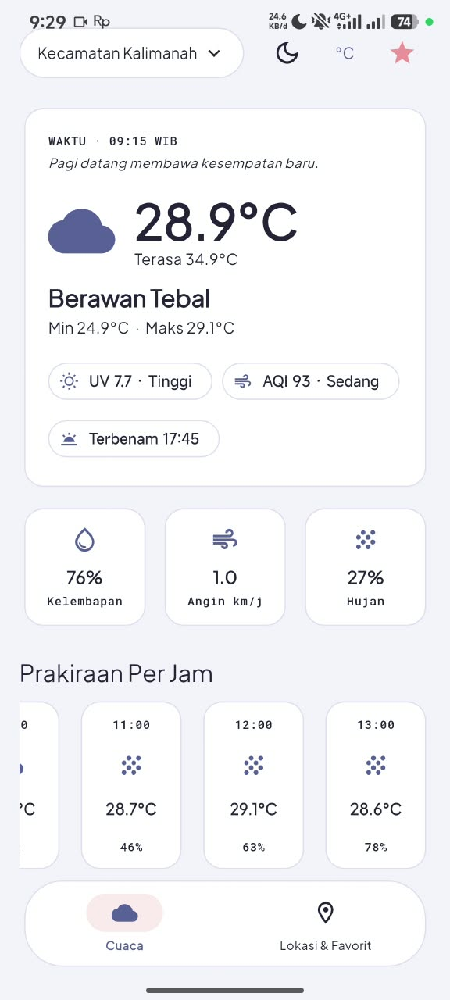
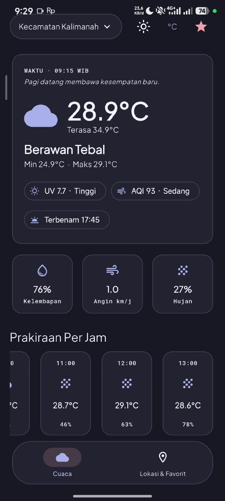
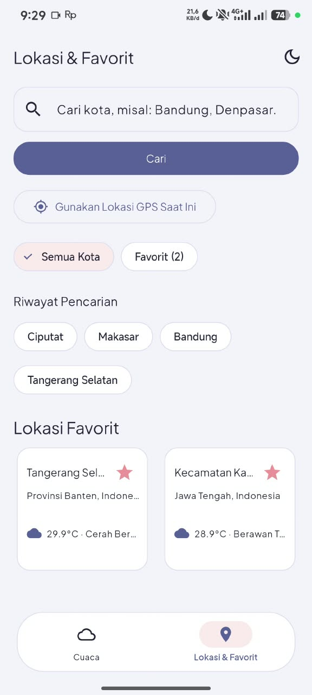
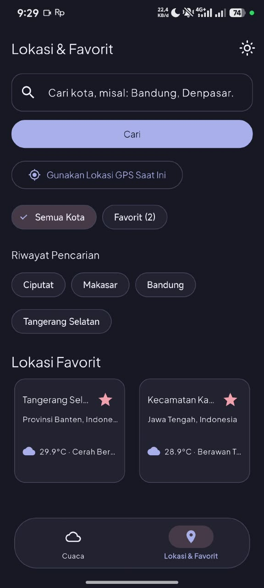

# Cuaca App — Responsi Flutter

Aplikasi cuaca berbahasa Indonesia yang mengambil data dari Open-Meteo. Proyek menggunakan Flutter, Material 3, arsitektur MVVM, dan Provider.

**Nama:** Haydar Ali Furqon 
**NIM:** H1D024025  
**Program studi/universitas:** Informatika/Unsoed

## Fitur

- Cuaca terkini, prakiraan per jam, dan prakiraan 5 hari.
- Detail suhu, suhu terasa, kelembapan, kecepatan angin, peluang hujan, indeks UV, dan kualitas udara (AQI).
- Pencarian kota melalui Open-Meteo Geocoding API.
- Lokasi favorit, riwayat pencarian maksimal lima kota, dan lokasi terakhir disimpan lokal.
- Tema terang dan tema gelap **Kataware-doki** tersimpan dan dimuat saat aplikasi dibuka.
- Satuan suhu Celsius/Fahrenheit tersimpan dan digunakan pada tampilan suhu.
- Kartu cuaca favorit mengambil data cuaca dari API Open-Meteo.
- Tampilan loading, data kosong, dan error dengan aksi coba lagi pada layar cuaca/pencarian.
- Navigasi bawah antara layar Cuaca dan Lokasi & Favorit.
- GPS untuk menentukan secara cepat lokasi saat ini


## Screenshot
| Tampilan | Nama file |
|---|---|
| Home (Siang) |  |
| Home (Gelap) |  |
| Lokasi (Siang) |  |
| Lokasi (Gelap) |  |

## Teknologi

- Flutter dan Dart
- Material Design 3
- Provider (`ChangeNotifier`)
- `http` untuk request GET
- `shared_preferences` untuk penyimpanan lokal
- Google Fonts: Plus Jakarta Sans dan Roboto Mono
- Open-Meteo Forecast, Air Quality, dan Geocoding API

## Struktur Proyek dan MVVM

```text
lib/
├── core/
│   ├── theme/
│   │   └── app_theme.dart
│   └── utils/
│       └── weather_code.dart
├── models/
│   ├── air_quality_model.dart
│   ├── location_model.dart
│   └── weather_model.dart
├── services/
│   ├── geocoding_service.dart
│   ├── storage_service.dart
│   └── weather_service.dart
├── viewmodels/
│   ├── location_viewmodel.dart
│   ├── settings_viewmodel.dart
│   ├── view_state.dart
│   └── weather_viewmodel.dart
├── views/
│   ├── home_screen.dart
│   ├── location_screen.dart
│   ├── main_shell.dart
│   └── widgets/
│       ├── weather_cards.dart
│       ├── weather_forecasts.dart
│       └── weather_header.dart
└── main.dart
```

### Tanggung jawab tiap layer

- **Models** — parsing JSON API dan merepresentasikan lokasi, cuaca, serta kualitas udara.
- **Services** — request HTTP ke Open-Meteo dan baca/tulis preferensi lokal.
- **ViewModels** — mengelola state layar, memanggil service, menyimpan preferensi, dan menyediakan data turunan untuk UI.
- **Views** — menampilkan state dari ViewModel. View tidak membuat request HTTP secara langsung.
- **Core** — konfigurasi tema dan pemetaan kode cuaca WMO ke teks/ikon.

`main.dart` membuat service dan ViewModel, memuat preferensi tema sebelum `runApp`, lalu menyediakan state aplikasi melalui `MultiProvider`.

## Implementasi API

Semua request menggunakan metode **GET**, dan respons JSON dipetakan secara manual ke model Dart.

### Prakiraan cuaca

**Endpoint:** `https://api.open-meteo.com/v1/forecast`

| Parameter/field | Penggunaan di aplikasi |
|---|---|
| `latitude`, `longitude` | Koordinat lokasi yang dipilih |
| `current=temperature_2m` | Suhu utama |
| `current=apparent_temperature` | Suhu terasa |
| `current=relative_humidity_2m` | Kartu kelembapan |
| `current=wind_speed_10m` | Kartu kecepatan angin |
| `current=weather_code`, `is_day`, `time` | Kondisi, ikon, dan waktu data |
| `hourly=temperature_2m` | Suhu prakiraan per jam |
| `hourly=weather_code` | Kondisi dan ikon per jam |
| `hourly=precipitation_probability` | Peluang hujan per jam dan saat ini |
| `daily=temperature_2m_min`, `temperature_2m_max` | Suhu minimum/maksimum harian |
| `daily=weather_code` | Kondisi prakiraan harian |
| `daily=precipitation_probability_max` | Peluang hujan maksimum harian |
| `daily=uv_index_max` | Indeks dan kategori UV |
| `daily=sunset` | Waktu matahari terbenam |
| `timezone=auto`, `forecast_days=5` | Waktu lokal lokasi dan prakiraan lima hari |

### Kualitas udara

**Endpoint:** `https://air-quality-api.open-meteo.com/v1/air-quality`

`current=us_aqi` digunakan untuk menampilkan nilai AQI dan kategorinya. Data AQI bersifat tambahan; bila request gagal, informasi cuaca utama tetap dapat ditampilkan.

### Pencarian kota

**Endpoint:** `https://geocoding-api.open-meteo.com/v1/search`

Parameter yang digunakan: `name`, `count=5`, `language=id`, dan `format=json`. Hasil pencarian berisi nama kota, provinsi/administrasi, negara, serta koordinat.

## Penyimpanan Lokal

`shared_preferences` menyimpan daftar lokasi favorit, maksimal lima riwayat pencarian terbaru, lokasi terakhir, tema, dan satuan suhu. Data lokasi disimpan sebagai JSON dan dimuat kembali saat aplikasi dijalankan.

## Cara Menjalankan

Pastikan Flutter SDK sudah terpasang, lalu jalankan dari root proyek:

```bash
flutter pub get
flutter run
```

Untuk memeriksa analisis statis:

```bash
flutter analyze
```

